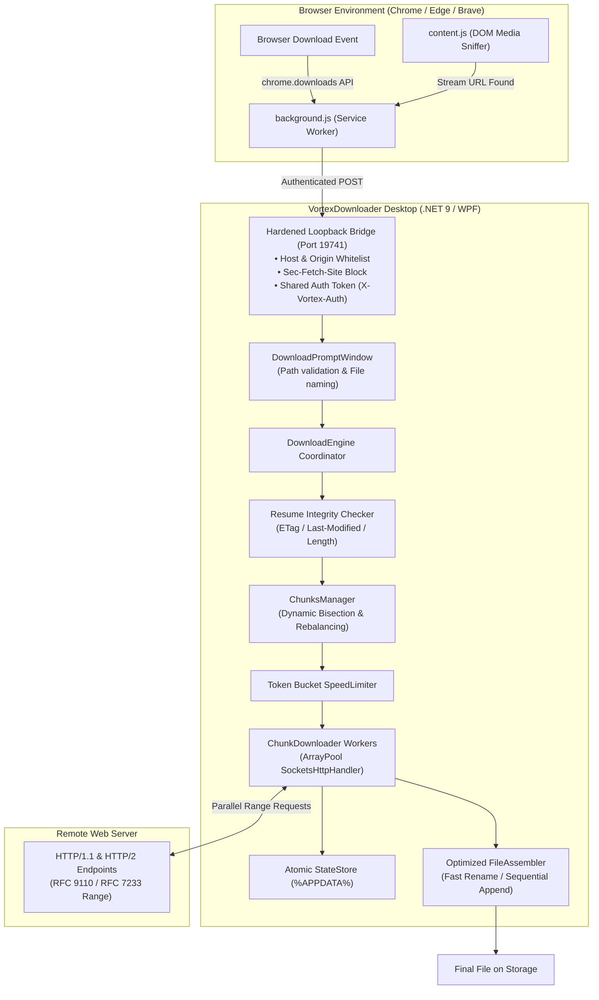

<div align="center">


# VortexDownloader ⚡

**High-performance, multi-threaded segmented download manager built with .NET 9 and modern WPF.**  
*Independent Clean-Room Implementation • Low-Allocation Pooled Streaming • Dynamic Chunk Bisection • Browser Companion*

> *"Veriyi bekleme; onu girdaba çek." — "Don't wait for data. Pull it into the vortex."*

[](LICENSE)
[](https://dotnet.microsoft.com/download/dotnet/9.0)
[](https://microsoft.com/windows)
[](https://github.com/Armone0/VortexDownloader/releases)
[](tests/)
[](DISCLAIMER.md)

[Features](#-key-features) • [Installation & Setup](#-installation--setup-guide) • [Browser Extension](#-browser-extension-setup) • [Architecture](#-architecture) • [Comparison](#-feature-comparison) • [Security](#-security--integrity) • [Legal Notice](#-legal-notice)

</div>

---

## 📖 Overview

**VortexDownloader** is an open-source download manager engineered from scratch using clean-room principles. Built with **C# 13**, **.NET 9 `SocketsHttpHandler`**, memory-pooled stream buffers, and a dark **WPF UI**, it delivers efficient multi-part downloads over HTTP/1.1 and HTTP/2.

Rather than relying on static file partitioning where slow connections stall completion at the end of a transfer, VortexDownloader actively monitors in-flight workers. When an active thread finishes its assigned segment, it dynamically locates the chunk with the largest remaining byte range and splits it in half (`FindMaxFreeChunk`), mitigating tail latency.

---

## 🚀 Key Features

* **⚡ Dynamic Chunk Bisection (`FindMaxFreeChunk`):**  
  Mitigates tail latency at the end of downloads. When an active worker finishes early, it dynamically bisects the largest remaining active chunk so idle threads assist with the remaining data.
* **🧠 Low-Allocation Pooled Buffer Streaming:**  
  Uses `SocketsHttpHandler` combined with `ArrayPool<byte>.Shared` (80 KB pooled buffers) to stream network chunks directly to disk with minimal GC allocations in the hot path.
* **📦 Remote ZIP Central Directory Peek (`ZipInspector`):**  
  Queries the end of remote `.zip` archives via HTTP Range requests to parse Central Directory records, displaying file listings and uncompressed sizes before downloading the archive.
* **🚦 Concurrency Queue Manager:**  
  Configurable concurrent download slots (1, 2, 3, 5, or Unlimited). Automatically manages queued tasks in FIFO order as slots become available.
* **💤 System Sleep Management (`ShutdownManager`):**  
  Prevents Windows from entering sleep mode during active transfers via `SetThreadExecutionState`, and optionally powers off or sleeps the computer upon queue completion.
* **🎥 Floating Video Grabber Companion Extension:**  
  Browser extension with a content script that detects HTML5 `<video>` tags, direct MP4, WebM, and media stream URLs, displaying a one-click button to send the URL to VortexDownloader.  
  *(Note: Multi-segment HLS `.m3u8` playlist transmuxing requires separate segment concatenation and is planned for a future release).*
* **📋 Batch Multi-URL Downloads:**  
  Enqueue collections of URLs separated by newlines or commas in a single step.
* **🎯 Token-Bucket Speed Limiter:**  
  Token-bucket rate limiter enabling customizable bandwidth caps (e.g., 1 MB/s, 5 MB/s, 10 MB/s, or Unlimited).
* **🛡️ Atomic State Persistence:**  
  Download state and chunk offsets are atomically persisted to `%APPDATA%\VortexDownloader\tasks.json`. Interrupted transfers can be resumed without data corruption.
* **🎨 Dynamic Soft Loft Theme Engine (`ThemeManager`):**  
  Switch instantly at runtime between Dark Theme (`#071B2B`, `#167D8D`, `#B9E4E8`, `#EEEEEE`) and Light Theme (`#FFCED8`, `#FFDDDD`, `#FFF4DE`, `#FFE8C4`) without restarting the application.
* **🌐 Instant Multi-Language Support (`LocalizationManager`):**  
  Full dynamic runtime internationalization supporting English and Turkish (Türkçe).
* **⚙️ Tabbed Settings Window (`SettingsWindow`):**  
  Motrix-inspired settings window persisting configuration (`%APPDATA%\VortexDownloader\settings.json`) for default download paths, concurrency limits, and auto-shutdown.
* **🎨 Modern Windows UI:**  
  Clean interface featuring category filters (*All, Downloading, Paused, Completed*), live speed metrics, progress bars, and system tray minimization.
* **💾 Pre-Flight Disk Space Validation:**  
  Checks available drive capacity before starting a transfer to prevent disk-full crashes mid-stream.

---

## 🛠️ Architecture



---

## 📦 Installation & Setup Guide

### Option 1: Download Ready-to-Run Portable Package (Recommended)

1. Navigate to the [**Releases**](https://github.com/Armone0/VortexDownloader/releases/tag/v1.3.1) page.
2. Download **`VortexDownloader-v1.3.1-win-x64.zip`**.
3. Extract the ZIP archive to your preferred location.
4. Run **`VortexDownloader.exe`**.
   * Completely **self-contained portable executable** (no external .NET runtime installation required).
   * Minimizes cleanly to the Windows notification tray.

> [!NOTE]
> **Windows SmartScreen Notice:**  
> Because open-source binaries are not signed with an expensive commercial EV code-signing certificate, Windows SmartScreen may show an informational banner on first run (*"Windows protected your PC"*). Click **"More info" (Ek bilgi)** and select **"Run anyway" (Yine de çalıştır)** to proceed.

---

### Option 2: Build from Source (.NET 9 SDK)

#### Prerequisites
* Windows 10 (Build 19041+) or Windows 11
* [.NET 9.0 SDK](https://dotnet.microsoft.com/download/dotnet/9.0)
* Git

#### Step-by-Step Instructions

1. **Clone the repository:**
   ```bash
   git clone https://github.com/Armone0/VortexDownloader.git
   cd VortexDownloader
   ```

2. **Restore dependencies & build:**
   ```bash
   dotnet restore
   dotnet build -c Release
   ```

3. **Run unit tests:**
   ```bash
   dotnet test
   ```
   *(All 37 unit tests verify dynamic range arithmetic, speed throttling, resume integrity, path traversal prevention, state serialization, and safe file assembly).*

4. **Launch the application:**
   ```bash
   dotnet run --project src/VortexDownloader.UI -c Release
   ```

5. **(Optional) Publish single-file self-contained binary:**
   ```bash
   dotnet publish src/VortexDownloader.UI -c Release -r win-x64 --self-contained true -p:PublishSingleFile=true -p:IncludeNativeLibrariesForSelfExtract=true -o ./publish
   ```

---

## 🌐 Browser Extension Setup

VortexDownloader includes a Manifest V3 companion extension in the [`extension/`](extension/) directory.

```
extension/
├── manifest.json       # Manifest V3 extension configuration
├── background.js       # Background download capture service worker
├── content.js          # Injected content script for DOM video detection
├── content.css         # Styling for floating video grabber overlay
├── icons/              # Extension icons (16, 32, 48, 128 px)
└── README.md           # Extension documentation
```

### Installation Steps (Chrome / Edge / Brave):

1. Open your browser and navigate to:
   * **Chrome:** `chrome://extensions`
   * **Microsoft Edge:** `edge://extensions`
   * **Brave:** `brave://extensions`
2. Toggle on **Developer mode** (*Geliştirici modu*) in the top-right corner.
3. Click the **Load unpacked** (*Paketlenmemiş öğe yükle*) button.
4. Select the `extension/` directory inside your `VortexDownloader` folder.
5. Ensure `VortexDownloader.exe` is running on your desktop.
6. When starting a download in your browser, the extension intercepts the request and opens the Vortex prompt.

> [!TIP]
> **Graceful Fallback:** If the VortexDownloader desktop application is closed, the extension falls back to standard browser downloads.

---

## 🔒 Security & Integrity

The desktop application and browser extension interact through a local loopback bridge with defense-in-depth security measures:

1. **Host Header Validation:** Rejects requests where the `Host` header does not match `127.0.0.1` or `localhost`, preventing DNS rebinding vulnerabilities.
2. **Sec-Fetch-Site Filtering:** Blocks any request where `Sec-Fetch-Site` is set to `cross-site`, preventing third-party websites from making unauthorized loopback calls.
3. **Origin Whitelist:** Restricts allowed origins strictly to browser extension schemes (`chrome-extension://`, `edge-extension://`, `moz-extension://`).
4. **Shared Authentication Token:** Requires a shared authentication token header (`X-Vortex-Auth`) for all IPC operations.
5. **Path Traversal & Filename Sanitization:** Enforces `Path.GetFileName` and strips invalid characters via `Path.GetInvalidFileNameChars()`. Rejects non-HTTP/HTTPS URI schemes.
6. **Resume Integrity Verification:** When resuming a paused or interrupted transfer, VortexDownloader verifies `ETag`, `Last-Modified` (RFC 7232), and `Content-Length`. If the remote resource has been modified on the server, chunks are safely reset to prevent file corruption.

---

## ⚖️ Feature Comparison

| Capability | Standard Browser | Traditional Commercial IDM | VortexDownloader ⚡ |
| :--- | :---: | :---: | :---: |
| **Multi-Stream Segmentation** | Single-stream (1) | Up to 32 | Up to 32 (Configurable) |
| **Tail Chunk Bisection** | ❌ None | Dynamic Slicing | Dynamic Bisection (`FindMaxFreeChunk`) |
| **Buffer Management** | Standard heap allocations | Proprietary buffers | Pooled buffers via `ArrayPool<byte>` |
| **Remote ZIP Inspection** | ❌ Full download required | Partial preview | Range-based Central Directory Peek |
| **Loopback Security** | N/A | Native Messaging Host | Hardened Loopback + Token + Host/Origin check |
| **Resume Integrity** | Basic | Range / ETag | Multi-factor (ETag, Last-Modified, Length) |
| **Interface Design** | Basic browser UI | Classic Win32 GDI | Modern Windows 11 Dark UI |
| **Source Code & License** | Proprietary | Proprietary (Paid commercial) | 100% Open Source (Apache 2.0) |

---

## 🧪 Testing with Real Links

Test multi-threaded segmented acceleration using these public test files:

```text
# 100 MB HTTPS Test File (Cloudflare CDN)
https://speed.cloudflare.com/__down?bytes=104857600

# 100 MB HTTPS Test File (OVH Network)
https://proof.ovh.net/files/100Mb.dat

# 100 MB HTTP Test Archive (Supports Range requests)
http://ipv4.download.thinkbroadband.com/100MB.zip

# 512 MB HTTP Test Archive
http://ipv4.download.thinkbroadband.com/512MB.zip
```

1. Click **`[ ＋ Yeni İndirme Ekle ]`** in the application sidebar.
2. Paste the URL into the dialog.
3. Select the desired chunk count (e.g., 8 or 16 threads).
4. Observe concurrent chunk progress updating in real time.

---

## 📜 Legal Notice

VortexDownloader is an independent, clean-room open-source project developed in accordance with:
* **RFC 9110:** HTTP Semantics (Range Requests)
* **RFC 7233:** Range Requests specification

> [!IMPORTANT]
> - This project contains **no proprietary binaries, decompiled source code, or assets** from commercial download utilities.
> - "Internet Download Manager" and "IDM" are trademarks of Tonec Inc. VortexDownloader is not affiliated with, endorsed by, or sponsored by Tonec Inc.
> - For full legal notices and non-affiliation disclaimers, please consult [DISCLAIMER.md](DISCLAIMER.md).

---

## 🤝 Contributing

Contributions, bug reports, and suggestions are welcome!
1. Fork the Project
2. Create your Feature Branch (`git checkout -b feature/AmazingFeature`)
3. Commit your Changes (`git commit -m 'feat: add amazing feature'`)
4. Ensure all 37 tests pass (`dotnet test`)
5. Push to the Branch (`git push origin feature/AmazingFeature`)
6. Open a Pull Request

---

## 📄 License

Distributed under the **Apache License 2.0**. See [`LICENSE`](LICENSE) for more information.

<div align="center">
<sub>Crafted with C# 13 and .NET 9.</sub>
</div>
