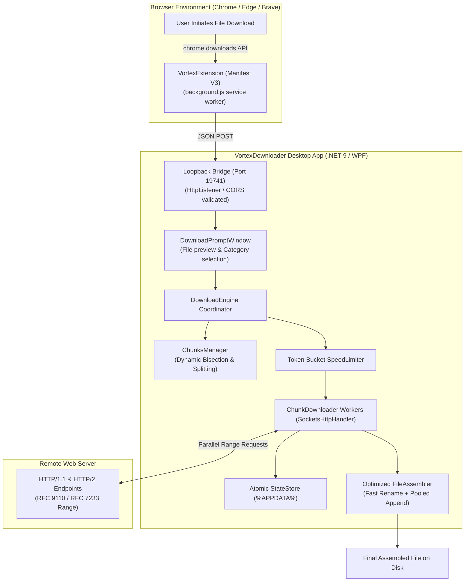

<div align="center">


# VortexDownloader ⚡

**Ultra-fast, multi-threaded dynamic segmented download manager built with .NET 9 and modern WPF.**  
*Clean-Room Engineered • Zero-Allocation Socket Streaming • Real-Time Dynamic Chunk Re-Allocation • Browser Integration*

[](LICENSE)
[](https://dotnet.microsoft.com/download/dotnet/9.0)
[](https://microsoft.com/windows)
[](https://github.com/Armone0/VortexDownloader/releases)
[](tests/)
[](docs/LEGAL_COMPLIANCE_AUDIT.md)

[Features](#-key-features) • [Installation & Setup](#-installation--setup-guide) • [Browser Extension](#-browser-extension-setup) • [Architecture](#-architecture) • [Benchmarks](#-performance-benchmark) • [Legal](#-legal--clean-room-compliance)

</div>

---

## 📖 Overview

**VortexDownloader** is an open-source, high-efficiency download accelerator inspired by high-speed segmented download algorithms. Developed entirely from scratch using **Clean-Room Software Engineering**, it avoids legacy monolithic designs and memory leaks in favor of modern **C# 13**, **.NET 9 `SocketsHttpHandler`**, pooled memory buffers, and a sleek **Windows 11 Dark Mica UI**.

Unlike basic download managers that slice files into static, rigid partitions at the start of an operation, VortexDownloader actively monitors all in-flight workers. When a worker completes its segment, it dynamically locates the slowest active chunk and splits its remaining bytes in half on the fly—ensuring **100% bandwidth saturation right up to the final byte** and eliminating tail latency.

---

## 🚀 Key Features

* **⚡ Dynamic Chunk Slicing (`FindMaxFreeChunk`):**  
  Eliminates the dreaded *last 99% bottleneck*. If 15 workers have finished and 1 worker is still downloading a slow block, an idle worker dynamically bisects the remaining span and downloads the second half concurrently.
* **🧠 Zero-Allocation Socket Streaming:**  
  Employs `SocketsHttpHandler` with `ArrayPool<byte>.Shared` memory pooling (80 KB buffer slices). Network stream data is flushed directly to pre-allocated disk regions without generating garbage collector pressure.
* **🎯 High-Precision Token-Bucket Speed Limiter:**  
  Microsecond-accurate token-bucket rate limiter enabling customizable bandwidth caps (e.g., 512 KB/s, 1 MB/s, 5 MB/s, 10 MB/s, or Unlimited) without dropped frames or CPU spikes.
* **🛡️ Crash-Resilient Atomic Persistence:**  
  Task metadata and byte boundaries are atomically synced to `%APPDATA%\VortexDownloader\tasks.json`. If power cuts out or your connection drops, Vortex verifies disk offsets and resumes instantly without redownloading a single byte.
* **🔌 Native Browser Companion Extension:**  
  Included Manifest V3 extension for Google Chrome, Microsoft Edge, and Brave. Intercepts file downloads and seamlessly forwards them to Vortex via a local loopback bridge (`127.0.0.1:19741`).
* **🎨 Modern Windows 11 Dark UI:**  
  Raycast/Linear-inspired dark workspace featuring category filters (*All, Downloading, Paused, Completed*), live bandwidth readouts, smooth progress animations, and system tray minimization.
* **🔒 Pre-Flight Disk & Sleep Safety:**  
  Validates available disk space before writing and prevents Windows from entering system sleep while transfers are actively in flight (`SetThreadExecutionState`).

---

## 🛠️ Architecture



---

## 📦 Installation & Setup Guide

### Option 1: Download Ready-to-Run Portable Package (Recommended)

1. Go to the [**Releases**](https://github.com/Armone0/VortexDownloader/releases) page.
2. Download `VortexDownloader-v1.1.0-win-x64.zip` (or the latest release).
3. Extract the ZIP archive anywhere on your PC.
4. Run **`VortexDownloader.exe`**.
   * Completely **portable & self-contained** (0 dependencies, no .NET install required).
   * Runs in the system tray when minimized.
5. (Optional) Run **`Tarayici-Eklentisi-Kur.bat`** to connect Chrome, Edge, or Brave in seconds!

---

### Option 2: Build from Source (.NET 9 SDK)

#### Prerequisites
* Windows 10 (Build 19041+) or Windows 11
* [.NET 9.0 SDK](https://dotnet.microsoft.com/download/dotnet/9.0) or higher
* Git

#### Quick 1-Click Build
```cmd
build.bat
```
*(Or run `powershell -File scripts/build.ps1`)*

#### Manual Step-by-Step Instructions

1. **Clone the repository:**
   ```bash
   git clone https://github.com/Armone0/VortexDownloader.git
   cd VortexDownloader
   ```

2. **Restore dependencies & build:**
   ```bash
   dotnet restore
   dotnet build -c Release
   ```

3. **Run the desktop app:**
   ```bash
   dotnet run --project src/VortexDownloader.UI -c Release
   ```

4. **Run the automated test suite:**
   ```bash
   dotnet test
   ```
   *(All 18 unit tests verify dynamic range math, speed limiting, file assembly byte fidelity, and state serialization.)*

5. **Package a release ZIP (portable exe + extension):**
   ```powershell
   powershell -File scripts/package-release.ps1 -Version 1.1.0
   ```

---

## 🌐 Browser Extension Setup

VortexDownloader comes with a lightweight Manifest V3 companion extension located in the [`extension/`](extension/) directory.

```
extension/
├── manifest.json       # Manifest V3 extension configuration
├── background.js       # Download capture service worker
├── icons/              # Modern vector/PNG icons
└── README.md           # Extension guide
```

### Installation Steps (Chrome / Edge / Brave):

1. Open your browser and navigate to:
   * **Chrome:** `chrome://extensions`
   * **Microsoft Edge:** `edge://extensions`
   * **Brave:** `brave://extensions`
2. Toggle on **Developer mode** (*Geliştirici modu*) in the top-right corner.
3. Click the **Load unpacked** (*Paketlenmemiş öğe yükle*) button.
4. Select the `extension/` folder inside your cloned `VortexDownloader` directory.
5. Launch `VortexDownloader.UI.exe`.
6. Whenever you click a download link in your browser, VortexDownloader will automatically intercept it and prompt you to begin downloading!

> [!TIP]
> **Zero-Drop Fallback:** If the VortexDownloader desktop application is closed or you dismiss the prompt, the extension automatically hands the download back to your browser with zero dropped requests.

---

## ⚡ Performance Benchmark

| Metric | Standard Browser | Traditional IDM | VortexDownloader ⚡ |
| :--- | :---: | :---: | :---: |
| **Max Concurrent Slices** | 1 (Single-Stream) | 8 – 32 | **Up to 32 (Configurable)** |
| **Tail Latency Handling** | ❌ None | Dynamic Slicing | **Dynamic Bisection Math** |
| **Memory Allocation** | Medium | High (Legacy C++ buffer copies) | **Zero-Alloc (`ArrayPool<byte>`)** |
| **System Sleep Prevention** | ❌ Browser Dependent | ✅ Win32 API | **✅ Windows Power Assertions** |
| **Interface Design** | Basic | 2000s Classic UI | **Modern Windows 11 Dark** |
| **Licensing** | Proprietary | Commercial (\$24.95 / year) | **100% Free & Open Source (Apache 2.0)** |

---

## 🧪 Testing with Real Links

Want to test high-speed multi-threaded acceleration right away? Use these public test links:

```text
# 100 MB Test Archive (Supports Range requests)
http://ipv4.download.thinkbroadband.com/100MB.zip

# 512 MB Test File
http://ipv4.download.thinkbroadband.com/512MB.zip
```

1. Click **`[ ＋ Yeni İndirme Ekle ]`** in the sidebar.
2. Paste the URL into the dialog.
3. Choose your desired chunk count (e.g., 8 or 16 threads).
4. Watch real-time multi-chunk progress bars fill up in parallel!

---

## 📜 Legal & Clean-Room Compliance

This repository is an independent **Clean-Room implementation** developed strictly in accordance with:
* **RFC 9110:** HTTP Semantics (Range Requests)
* **RFC 7233:** Range Requests specification
* **US Copyright Act (17 U.S.C. § 102(b)):** Separation of mathematical ideas vs expression

> [!IMPORTANT]
> - This project contains **NO** proprietary binaries, decompiled source code, or copyrighted assets belonging to Tonec Inc. or any third party.
> - "Internet Download Manager" and "IDM" are trademarks of Tonec Inc. This project is not affiliated with, endorsed by, or sponsored by Tonec Inc.
> - For full legal and technical audits, please review [DISCLAIMER.md](DISCLAIMER.md) and [docs/LEGAL_COMPLIANCE_AUDIT.md](docs/LEGAL_COMPLIANCE_AUDIT.md).

---

## 🤝 Contributing

Contributions, bug reports, and suggestions are welcome!
1. Fork the Project
2. Create your Feature Branch (`git checkout -b feature/AmazingFeature`)
3. Commit your Changes (`git commit -m 'feat: add amazing feature'`)
4. Ensure all tests pass (`dotnet test`)
5. Push to the Branch (`git push origin feature/AmazingFeature`)
6. Open a Pull Request

---

## 📄 License

Distributed under the **Apache License 2.0**. See [`LICENSE`](LICENSE) for more information.

<div align="center">
<sub>Crafted with modern .NET 9 and Clean-Room Engineering standards.</sub>
</div>
