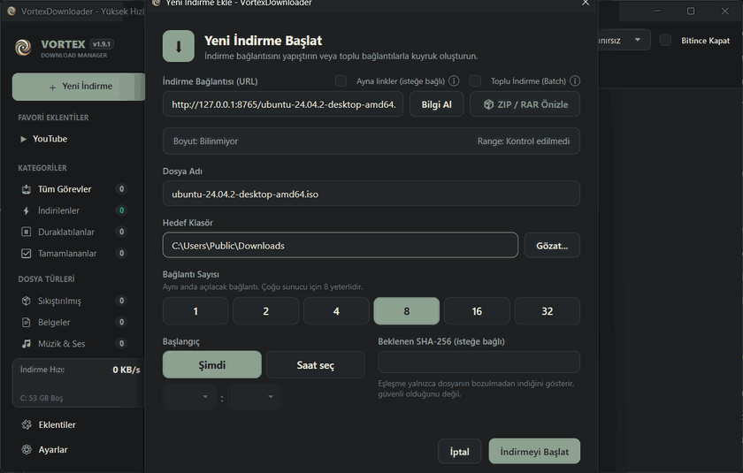
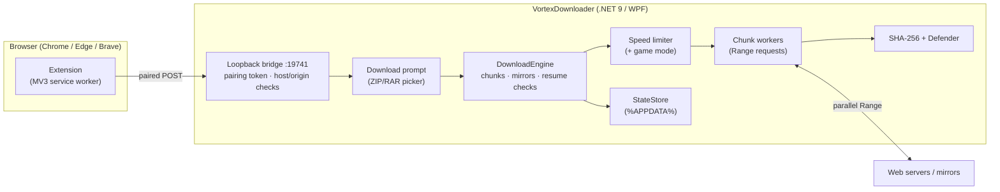

<div align="center">


# VortexDownloader

**A fast, open-source download manager for Windows.**
Segmented downloads, browser capture, and file picking inside remote ZIP/RAR archives, with no ads or telemetry.

[](https://github.com/Armone0/VortexDownloader/releases/latest)
[](https://github.com/Armone0/VortexDownloader/releases)
[](#-quick-start)
[](https://dotnet.microsoft.com/download/dotnet/9.0)
[](https://github.com/Armone0/VortexDownloader/actions/workflows/ci.yml)
[](LICENSE)

### [⬇️ Download for Windows](https://github.com/Armone0/VortexDownloader/releases/latest)

<sub>Portable · single .exe · no .NET runtime needed · or install with one command: <code>irm https://raw.githubusercontent.com/Armone0/VortexDownloader/main/install.ps1 | iex</code></sub>

<br/>



[Features](#-features) · [Quick start](#-quick-start) · [Browser extension](#-browser-extension) · [Security](#-security--privacy) · [Build](#-build-from-source) · [FAQ](#-faq) · [Türkçe](#-türkçe)

</div>

---

## ✨ Highlights

- **Up to 32 connections per file.** When a connection finishes early, the largest remaining piece is split in half so idle connections help finish the tail.
- **Take only what you need from an archive.** Open a remote `.zip` or `.rar`, tick the files you want, and only those bytes are downloaded through HTTP Range requests.
- **Works with your browser.** The Chrome/Edge/Brave extension sends downloads to Vortex together with the page's cookies, so files behind a login (such as Moodle) work too.
- **Checks every file.** Finished downloads get a SHA-256 hash and a Windows Defender scan, and the card shows a "Clean" or "Threat found" badge.

## 🚀 Features

| | |
| :--- | :--- |
| ⚡ **Segmented engine** | 1–32 connections, dynamic chunk splitting, pooled buffers (`ArrayPool<byte>`), and HTTP/1.1 and HTTP/2 via `SocketsHttpHandler`. |
| ⇄ **Multi-mirror** | Add mirror URLs for the same file. Chunks are spread across every valid mirror so speeds add up, and if one drops its chunks move to the others. |
| 🗜️ **ZIP & RAR file picking** | Lists an archive's contents without downloading it. Picked files are fetched by Range, CRC-32 checked, and never overwrite existing files. RAR5 (RAR4 via the library, untested) and solid archives are supported. |
| 🎮 **PS4 PKG info** | See a `.pkg`'s title, Title ID, content ID, version, required firmware, icon, file list and PARAM.SFO, even before downloading it. Unencrypted entries can be extracted; encrypted content is never decrypted. |
| 🐙 **GitHub releases** | Paste a repo URL to browse its releases and pick assets. GitHub's SHA-256 digest is checked automatically after download. |
| 📱 **Send from phone** | Scan a QR code and send a link from your phone on the same Wi-Fi. Off by default, runs only while the window is open (max 10 min), and every link needs your OK on the PC. |
| ⏰ **Scheduler & tools** | Start a download at a set time, check it against an expected SHA-256, remux video to MP4 or pull out the audio with ffmpeg, and sort downloads into folders by type. |
| 🔁 **Expired-link resume** | When a signed link expires, the downloaded data is kept. Download the file again from the page and Vortex continues where it stopped, checking the size and ETag/Last-Modified first. |
| 🎮 **Game mode** | While a fullscreen game, film or presentation runs, downloads slow to 256 KB/s – 1 MB/s. Your own limit comes back afterwards. |
| 🛡️ **Integrity & safety** | SHA-256 hash, Windows Defender scan, resume integrity checks (ETag, Last-Modified, length), and a disk-space check before each download. |
| 🌐 **Browser capture** | A Manifest V3 extension catches downloads and sends cookies, referrer and user agent. A one-time pairing in the app is required. A floating button grabs page videos. |
| 🎬 **Media** | Video and audio downloads through `yt-dlp` and `ffmpeg` (for example YouTube). Both are downloaded automatically the first time you use media. |
| 📋 **Queue & batch** | Paste many URLs at once. Set how many downloads run at once (1–5 or unlimited), pause or resume them all, and filter by category. |
| 🎯 **Speed limiter** | Token-bucket limit (1 / 5 / 10 MB/s or unlimited), applied across all downloads. |
| 💾 **Crash-safe state** | Progress is saved atomically to `%APPDATA%\VortexDownloader`, so interrupted downloads resume without corruption. |
| 🎨 **Polished UI** | Dark and light themes, English and Turkish, tray icon, Windows 11 taskbar progress, and options to stop sleep or shut down when done. |

## 📦 Quick start

**One command** (PowerShell). It downloads the latest release, checks its SHA-256, installs it to `%LOCALAPPDATA%\Programs\VortexDownloader` and adds a Start menu shortcut. Run it again to update.

```powershell
irm https://raw.githubusercontent.com/Armone0/VortexDownloader/main/install.ps1 | iex
```

**Or by hand:**

1. Download **`VortexDownloader-vX.Y.Z-win-x64.zip`** from the [latest release](https://github.com/Armone0/VortexDownloader/releases/latest).
2. Extract it anywhere and run **`VortexDownloader.exe`**.
3. *(Optional)* Install the browser extension (see below) so downloads from your browser go to Vortex.

> [!NOTE]
> The binary is not code-signed, so Windows SmartScreen may say *"Windows protected your PC"* on first run. Click **More info → Run anyway**. Every release has a `.sha256` file you can use to verify the download.

## 🧩 Browser extension

The extension lives in the [`extension/`](extension/) folder of the repository and is included in the release ZIP.

1. Open `chrome://extensions` (Edge: `edge://extensions`, Brave: `brave://extensions`).
2. Turn on **Developer mode**.
3. Click **Load unpacked** and select the `extension` folder.
4. Keep `VortexDownloader.exe` running. On first use the app asks you to approve the extension (one-time pairing).

If the app is closed, the browser downloads the file normally. Nothing is lost.

## 🔒 Security & privacy

- **No telemetry, no accounts, no ads.** Vortex only connects to the servers you download from. The one exception: the first time you use media downloads, it fetches `yt-dlp` (from GitHub) and `ffmpeg` (from gyan.dev).
- **Local bridge hardening.** The bridge listens only on `127.0.0.1:19741`. It checks the `Host` header (to block DNS rebinding), blocks cross-site `Sec-Fetch-Site` requests, and allows only extension origins.
- **Per-install pairing.** Each install generates a random 256-bit token, and only extensions you approved in the app can queue downloads. Tokens are compared in constant time.
- **Safe file writes.** File names are sanitized, archive paths can't escape the target folder (zip-slip protection), existing files are never overwritten, and decompressed output has a size cap.
- **Cookies stay with their site.** In multi-mirror downloads, the main site's cookies and referrer are never sent to other mirror hosts.
- **Send from phone is opt-in.** It listens on your private LAN address only while its window is open, needs a fresh random token, accepts only private-network clients, and never downloads without your confirmation.

Found a vulnerability? Please open a private security advisory on GitHub instead of a public issue.

<details>
<summary><b>🛠️ Architecture</b></summary>



| Project | What it holds |
| :--- | :--- |
| `src/VortexDownloader.Core` | Engine, chunk scheduling, ZIP/RAR readers, speed limiter, state store (no UI) |
| `src/VortexDownloader.UI` | WPF app, local bridge, dialogs, themes, localization |
| `extension/` | Chrome MV3 extension |
| `tests/VortexDownloader.Tests` | xUnit tests (engine, mirrors, archives, security, extension) |

</details>

## 🏗️ Build from source

Requirements: Windows 10 (19041+) or 11, [.NET 9 SDK](https://dotnet.microsoft.com/download/dotnet/9.0).

```bash
git clone https://github.com/Armone0/VortexDownloader.git
cd VortexDownloader
dotnet test
dotnet run --project src/VortexDownloader.UI -c Release
```

Single-file portable build:

```bash
dotnet publish src/VortexDownloader.UI -c Release -r win-x64 --self-contained true -p:PublishSingleFile=true -o publish
```

## 🗺️ Roadmap

- [x] PS4 PKG info, GitHub release picker, send from phone (QR), scheduler, memory soak test (v1.9)
- [x] ZIP & RAR file picking, multi-mirror, game mode (v1.8)
- [x] Expired-link resume, Defender + SHA-256, extension pairing (v1.7)
- [ ] Run the soak test in CI
- [ ] Chrome Web Store listing

See the full history in [CHANGELOG.md](CHANGELOG.md).

## ❓ FAQ

<details>
<summary><b>Is this related to Internet Download Manager (IDM)?</b></summary>

No. VortexDownloader is an independent clean-room project with no code, binaries or assets from any commercial product. "Internet Download Manager" and "IDM" are trademarks of Tonec Inc. See [DISCLAIMER.md](DISCLAIMER.md).
</details>

<details>
<summary><b>Why is my download not faster with more connections?</b></summary>

Some servers limit connections per user or do not support Range requests. In that case the card shows "Range: No" and the file downloads with one connection. For most servers, 8 connections is enough.
</details>

<details>
<summary><b>Can I pick files from a password-protected RAR?</b></summary>

Not yet. Encrypted entries are listed but can't be picked. Download the whole archive and extract it with your archiver.
</details>

<details>
<summary><b>Does it run on macOS or Linux?</b></summary>

No. The UI is WPF and Windows-only.
</details>

## 🤝 Contributing

Bug reports, ideas and pull requests are welcome. Please read [CONTRIBUTING.md](CONTRIBUTING.md) and make sure `dotnet test` passes before opening a PR.

## 🇹🇷 Türkçe

**VortexDownloader**, Windows için açık kaynaklı ve hızlı bir indirme yöneticisidir.

Tek komutla kurmak için PowerShell'e yapıştır: `irm https://raw.githubusercontent.com/Armone0/VortexDownloader/main/install.ps1 | iex`
- Dosyaları 32 bağlantıya kadar parçalayarak indirir ve birden fazla aynadan aynı anda çekebilir.
- ZIP ve RAR arşivlerinin içinden yalnızca istediğin dosyaları indirir.
- Oyun açıkken indirmeyi kendiliğinden yavaşlatır.
- İnen her dosyayı Windows Defender ile tarar.
- PS4 `.pkg` dosyalarının bilgisini (oyun adı, sürüm, gereken yazılım) indirmeden gösterir, GitHub sürümlerinden dosya seçtirir ve telefondan QR ile bağlantı almayı sağlar.

Arayüz Türkçe ve İngilizce kullanılabilir. [Son sürümü indir](https://github.com/Armone0/VortexDownloader/releases/latest) · [Değişiklik günlüğü](CHANGELOG.md)

## 📄 License

[Apache License 2.0](LICENSE). Third-party: [SharpCompress](https://github.com/adamhathcock/sharpcompress) (MIT) for RAR reading, [QRCoder](https://github.com/codebude/QRCoder) (MIT) for the phone QR code, and [yt-dlp](https://github.com/yt-dlp/yt-dlp) (Unlicense) for media.
