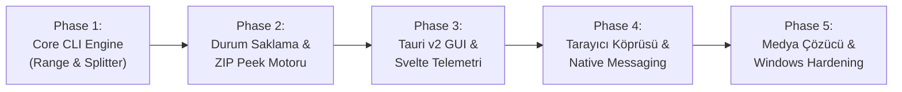

# Internet Download Manager (IDM) -> Rust + Tauri v2 Kapsamlı Göç ve Mimari Tasarım Rehberi (Migration Guide)

Bu belge, **Internet Download Manager (IDM)** yazılımının tersine mühendisliği ile ortaya çıkarılan patentli mekaniklerinin, algoritmalarının ve ağ protokollerinin; **.NET 9 prototipinden RUST + TAURI v2** mimarisine sıfır taviz (zero-compromise), bellek güvenli (memory-safe), ultra düşük kaynak tüketimli ve yüksek verimli (high-throughput) olarak taşınması için gereken **uçtan uca teknik mimariyi ve üretim sınıfı (production-grade) kod referanslarını** sunar.

---

## İÇİNDEKİLER
1. [Rust + Tauri v2 Mimari Şeması (Core Engine vs WebView2 GUI)](#1-rust--tauri-v2-mimari-şeması-core-engine-vs-webview2-gui)
2. [Seçilen Crates Listesi, Sürümler ve Derinlemesine Gerekçeler](#2-seçilen-crates-listesi-sürümler-ve-derinlemesine-gerekçeler)
3. [Dinamik Segmentasyon Motoru (`ChunksManager`) Rust Tasarımı ve Kodu](#3-dinamik-segmentasyon-motoru-chunksmanager-rust-tasarımı-ve-kodu)
4. [Token Bucket Hız Sınırlayıcı (`SpeedLimiter`) İmplementasyonu](#4-token-bucket-hız-sınırlayıcı-speedlimiter-implementasyonu)
5. [Crash Recovery ve Dayanıklı Durum Yönetimi (State Persistence)](#5-crash-recovery-ve-dayanıklı-durum-yönetimi-state-persistence)
6. [Sıfır Maliyetli Dosya Birleştirme (Fast Zero-Copy File Assembly)](#6-sıfır-maliyetli-dosya-birleştirme-fast-zero-copy-file-assembly)
7. [Tarayıcı Entegrasyonu ve IPC Köprüsü (Native Messaging & WebSocket)](#7-tarayıcı-entegrasyonu-ve-ipc-köprüsü-native-messaging--websocket)
8. [Akıllı Medya Akışı Muxing Motoru (DASH/HLS & FFmpeg)](#8-akıllı-medya-akışı-muxing-motoru-dashhls--ffmpeg)
9. [Beş Aşamalı Geliştirme ve Göç Yol Haritası (Phase 1 - Phase 5)](#9-beş-aşamalı-geliştirme-ve-göç-yol-haritası-phase-1---phase-5)

---

## 1. Rust + Tauri v2 Mimari Şeması (Core Engine vs WebView2 GUI)

Modern bir indirme yöneticisi, **kullanıcı arayüzü ile indirme çekirdeğini (core engine) kesin sınırlarla ayırmalıdır.** .NET 9 mimarisinde GC (Garbage Collection) döngüleri, multi-gigabit indirmelerde mikro takılmalara (micro-stutters) yol açabilir. Rust + Tauri v2 ile bu darboğaz tamamen ortadan kaldırılır.

### A. Mimari Tasarım İlkeleri
1. **Headless Core Engine (Daemon Mode):**
   - İndirme motoru, soket havuzları, disk yazıcıları ve IPC dinleyicileri tamamen bağımsız bir `tokio` multi-threaded runtime üzerinde koşar.
   - GUI penceresi kapatıldığında veya sistem tepsisine (system tray) küçültüldüğünde indirme hızı 1 bayt bile düşmez; WebView2 süreci arka planda CPU ve bellek tasarrufu için askıya alınabilir (throttle).
2. **Asenkron UI Köprüsü (Telemetry Event Throttling):**
   - Ağ soketinden gelen her 64 KB veri bloğunda doğrudan UI'a event fırlatılmaz (IPC flood önlenir).
   - Rust Core içerisinde 10 Hz veya 20 Hz hızında çalışan bir **Telemetry Ticker**, tüm aktif parçaların (chunks) ilerleme yüzdelerini, anlık hızları ve kalan süreleri toplayarak tek bir `serde` JSON paketi halinde `tauri::Emitter` ile WebView2 katmanına fırlatır.
3. **Sıfır Bellek Kopyalama (Zero-Heap-Alloc Hot Loop):**
   - Ağ kartından (`NIC`) okunan paketler `bytes::BytesMut` tamponlarına alınır ve doğrudan işletim sistemi disk arabelleğine (`ring buffer` / async file handle) iletilir.

### B. Sistem Mimarisi Şeması

```mermaid
flowchart TD
    subgraph BrowserSpace["Tarayıcı Katmanı (Chrome / Edge / Firefox)"]
        EXT["IDM WebExtension (MV3)\n(background.js / content.js)"]
    end

    subgraph NativeMessagingHost["Native Messaging & IPC Bridge"]
        NMH["idm-native-host.exe\n(Stdio 32-bit Framing JSON-RPC)"]
        WS["WebSocket Sunucusu\n(ws://127.0.0.1:1001)"]
        PIPE["Named Pipe Server\n(\\\\.\\pipe\\IDMNetworkMonitor)"]
    end

    EXT -->|Stdio JSON| NMH
    EXT -->|WebSocket Frames| WS
    NMH -->|Pipe Stream| PIPE

    subgraph RustCore["Rust Core Engine (Daemon Runtime - Tokio Full)"]
        ROUTER["IPC / Command Router\n(Arc<AppState>)"]
        PIPE --> ROUTER
        WS --> ROUTER

        subgraph TaskExecutionEngine["İndirme Görevi Yürütme Motoru"]
            DM["DownloadManager\n(Task Registry & State Machine)"]
            CM["ChunksManager\n(FindMaxFreeChunk Dynamic Splitter)"]
            SL["SpeedLimiter\n(Token Bucket Atomics)"]
            STATE["State Store (SQLite / WAL)\n(Crash Recovery Journal)"]
        end

        ROUTER --> DM
        DM --> CM
        DM --> SL
        DM --> STATE

        subgraph Workers["Paralel Asenkron HTTP Range Workers"]
            W1["Worker 1 (Range: 0-100MB)"]
            W2["Worker 2 (Range: 100MB-200MB)"]
            WN["Worker N (Dynamic Steal/Split)"]
        end

        CM -->|Spawn Worker| W1
        CM -->|Spawn Worker| W2
        CM -->|Dynamic Steal| WN

        subgraph DiskIO["Sıfır Kopyalı Disk Yazıcı"]
            PREALLOC["Sparse / Preallocated Target\n(SetFileValidData / set_len)"]
            ASSEMBLER["Stream Append / In-Place Write"]
        end

        W1 --> DiskIO
        W2 --> DiskIO
        WN --> DiskIO
    end

    subgraph TauriV2["Tauri v2 UI Katmanı"]
        TBRIDGE["Tauri IPC Commands & Events\n(tauri::command / tauri::Emitter)"]
        WEBVIEW["WebView2 Modern Frontend\n(Svelte 5 / React 19 / TypeScript)"]
        TRAY["System Tray & Global Shortcut Hook"]
    end

    DM -->|Batched Telemetry (10Hz)| TBRIDGE
    TBRIDGE -->|tauri::emit| WEBVIEW
    WEBVIEW -->|tauri::invoke| TBRIDGE
    TBRIDGE --> ROUTER
    TRAY --> ROUTER
```

---

## 2. Seçilen Crates Listesi, Sürümler ve Derinlemesine Gerekçeler

| Crate | Versiyon / Özellikler | Kullanım Amacı ve Mimari Gerekçe |
| :--- | :--- | :--- |
| **`tokio`** | `1.43` (`features = ["full"]`) | Çok çekirdekli iş-çalma (work-stealing) asenkron runtime. Ağ soketleri, zamanlayıcılar ve kanal mekanizmasının omurgasıdır. |
| **`reqwest`** | `0.12` (`features = ["stream", "rustls-tls", "cookies"]`) | Bağlantı havuzu (connection pool), TLS el sıkışmaları, proxy desteği ve HTTP/2 yeteneklerine sahip yüksek verimli HTTP istemcisi. |
| **`hyper` & `http-body-util`** | `1.5` / `0.1` | Aşırı düşük gecikmeli, `TCP_NODELAY`, `SO_RCVBUF` soket manipülasyonu ve özel HTTP başlık kontrolü gerektiğinde alt katman kontrolü. |
| **`bytes`** | `1.9` | Referans sayaçlı (`Arc` benzeri) bellek dilimleme. Ağdan gelen paketleri disk yazıcısına taşırken bellek kopyalamasını (heap reallocation) sıfıra indirir. |
| **`zerocopy`** | `0.8` (`features = ["derive"]`) | Binary wire protokolleri, ZIP EOCD başlıkları ve MP4 Box parsing işlemlerinde sıfır maliyetli güvenli struct casting sağlar. |
| **`parking_lot`** | `0.12` | Standart kütüphanedeki `std::sync::Mutex`'e göre 3-5 kat daha hızlı, zehirlenmeyen (poison-free) ve önbellek dostu senkronizasyon araçları. |
| **`tokio::fs` / `tokio::io`** | Dahili (`tokio`) | Bloklamayan asenkron dosya I/O operasyonları, `AsyncSeekExt`, `AsyncWriteExt` desteği. |
| **`interprocess`** | `2.2` (`features = ["tokio"]`) | Windows Named Pipes (`\\.\pipe\...`) ve Unix Domain Sockets için yerel, platformlar arası yüksek performanslı asenkron IPC kütüphanesi. |
| **`tokio-tungstenite`** | `0.24` (`features = ["connect"]`) | WebExtensions MV3 background service worker ile iki yönlü ultra hızlı asenkron WebSocket iletişimi. |
| **`tauri`** | `2.2` (`features = ["tray-icon"]`) | Son nesil hafif masaüstü framework'ü. Electron'a göre %90 daha düşük RAM (15-30 MB) ve anında açılma hızı sunar. |
| **`serde` & `serde_json`** | `1.0` | Tip güvenli serileştirme ve JSON Native Messaging protokolü çözümlemesi. |
| **`rusqlite`** | `0.32` (`features = ["bundled", "backup"]`) | İndirme görevlerinin durumu, parça sınırları ve geçmiş için WAL (Write-Ahead-Logging) modunda çalışan gömülü ACID veritabanı. |
| **`windows-sys`** | `0.59` (`features = ["Win32_Storage_FileSystem", "Win32_System_Ioctl"]`) | Windows sparse dosya ayarı (`FSCTL_SET_SPARSE`), disk alan ön-ayırması (`SetFileValidData`) ve donanımsal dosya kopyalama API'leri. |
| **`ffmpeg-next`** | `7.1` (veya saf Rust `mp4`) | DASH/HLS ile ayrı indirilen AAC/H264 video-ses kanallarını tek satır re-encode etmeden 1 saniyede mux eden FFmpeg C bindings. |

---

## 3. Dinamik Segmentasyon Motoru (`ChunksManager`) Rust Tasarımı ve Kodu

IDM'in en büyük başarısı, dosyayı baştan sabit $N$ eşit parçaya bölmemesidir. Çalışma zamanında (runtime) **en çok işi kalan parçayı tespit edip canlı olarak ikiye bölme (`FindMaxFreeChunk`)** ve **yavaşlayan bağlantının işini hızlı bağlantıya devretme (Tail Latency Prevention)** mekaniğidir.

### A. Veri Modeli ve Eşzamanlılık Mimarisi

```rust
use std::sync::Arc;
use parking_lot::RwLock;
use serde::{Serialize, Deserialize};

#[derive(Debug, Clone, Copy, PartialEq, Eq, Serialize, Deserialize)]
pub enum ChunkStatus {
    Idle,
    Downloading,
    Completed,
    Failed,
}

#[derive(Debug, Clone, Serialize, Deserialize)]
pub struct Chunk {
    pub id: usize,
    pub start_pos: u64,
    pub current_pos: u64,
    pub end_pos: u64,
    pub status: ChunkStatus,
    pub temp_file_name: String,
    pub last_speed_bps: u64,
}

impl Chunk {
    #[inline]
    pub fn remaining_bytes(&self) -> u64 {
        if self.current_pos >= self.end_pos || self.status == ChunkStatus::Completed {
            0
        } else {
            self.end_pos - self.current_pos
        }
    }
}

pub struct ChunksManager {
    pub total_size: u64,
    pub max_connections: usize,
    pub min_split_size: u64, // Örn: 1 MB (1_048_576 bytes)
    pub chunks: Arc<RwLock<Vec<Chunk>>>,
}
```

### B. `FindMaxFreeChunk` ve Canlı Bölünme (Dynamic Split) Algoritması

```rust
impl ChunksManager {
    pub fn new(total_size: u64, max_connections: usize, min_split_size: u64) -> Self {
        let initial_chunk = Chunk {
            id: 0,
            start_pos: 0,
            current_pos: 0,
            end_pos: total_size.saturating_sub(1),
            status: ChunkStatus::Idle,
            temp_file_name: "0.tmp".to_string(),
            last_speed_bps: 0,
        };

        Self {
            total_size,
            max_connections,
            min_split_size,
            chunks: Arc::new(RwLock::new(vec![initial_chunk])),
        }
    }

    /// IDM Patentli FindMaxFreeChunk Algoritması:
    /// Aktif olarak indirilen veya kuyrukta bekleyen tüm parçaları tarar,
    /// kalan iş yükü en büyük olan parçayı atomik olarak ortadan ikiye böler.
    pub fn split_largest_chunk(&self) -> Option<Chunk> {
        let mut chunks = self.chunks.write();

        // Maksimum bağlantı sınırına ulaşıldıysa yeni kanal açma
        if chunks.len() >= self.max_connections {
            return None;
        }

        let mut max_remaining = 0u64;
        let mut target_index = None;

        for (idx, chunk) in chunks.iter().enumerate() {
            if chunk.status != ChunkStatus::Completed {
                let remaining = chunk.remaining_bytes();
                // En az min_split_size (örn. 2 MB) veri kalmış olmalı
                if remaining >= (self.min_split_size * 2) && remaining > max_remaining {
                    max_remaining = remaining;
                    target_index = Some(idx);
                }
            }
        }

        if let Some(idx) = target_index {
            let chunk = &mut chunks[idx];
            let remaining = chunk.remaining_bytes();
            let half = remaining / 2;
            let midpoint = chunk.current_pos + half;

            let old_end_pos = chunk.end_pos;
            
            // Orijinal parçanın sınırını geriye çek (MidPoint)
            chunk.end_pos = midpoint;

            // Yeni parçayı oluştur: [midpoint + 1, old_end_pos]
            let new_chunk_id = chunks.len();
            let new_chunk = Chunk {
                id: new_chunk_id,
                start_pos: midpoint + 1,
                current_pos: midpoint + 1,
                end_pos: old_end_pos,
                status: ChunkStatus::Idle,
                temp_file_name: format!("{}.tmp", new_chunk_id),
                last_speed_bps: 0,
            };

            chunks.push(new_chunk.clone());
            Some(new_chunk)
        } else {
            None
        }
    }

    /// Bir parçanın indirme ilerlemesini atomik olarak günceller
    pub fn update_progress(&self, chunk_id: usize, bytes_read: u64, speed_bps: u64) -> bool {
        let mut chunks = self.chunks.write();
        if let Some(chunk) = chunks.get_mut(chunk_id) {
            chunk.current_pos = (chunk.current_pos + bytes_read).min(chunk.end_pos + 1);
            chunk.last_speed_bps = speed_bps;
            if chunk.current_pos > chunk.end_pos {
                chunk.status = ChunkStatus::Completed;
                return true; // Bu parça tamamlandı
            }
        }
        false
    }
}
```

### C. Tail Latency Önleme Mekanizması (Worker Stealing)

```rust
use tokio::time::{Duration, Instant};

pub struct TailLatencyGuard {
    pub stall_threshold: Duration,
    pub speed_disparity_ratio: f64, // Örn: 5x yavaşlık
}

impl TailLatencyGuard {
    /// İşi bitmiş olan boş bir iş parçacığı (idle worker) çağırır.
    /// Yavaşlayan veya takılan bir parçayı tespit eder, o soketi iptal edip işini çalar.
    pub fn should_steal_work(
        &self,
        manager: &ChunksManager,
        average_cluster_speed: u64,
    ) -> Option<(usize, u64, u64)> {
        let chunks = manager.chunks.read();
        
        for chunk in chunks.iter() {
            if chunk.status == ChunkStatus::Downloading {
                let remaining = chunk.remaining_bytes();
                // Kalan veri 512 KB'dan büyükse ve parça hızı ortalama küme hızının 1/5'inin altındaysa
                if remaining > 512 * 1024 {
                    let is_stalled = chunk.last_speed_bps < (average_cluster_speed / 5);
                    if is_stalled {
                        // İş çalınacak hedef: ChunkId, Yeni Başlangıç, Bitiş
                        return Some((chunk.id, chunk.current_pos, chunk.end_pos));
                    }
                }
            }
        }
        None
    }
}
```

---

## 4. Token Bucket Hız Sınırlayıcı (`SpeedLimiter`) İmplementasyonu

```rust
use std::sync::atomic::{AtomicBool, AtomicU64, Ordering};
use std::sync::Arc;
use tokio::sync::Notify;
use tokio::time::{interval, Duration};

pub struct SpeedLimiter {
    bytes_per_sec: AtomicU64,
    tokens: AtomicU64,
    enabled: AtomicBool,
    notify: Arc<Notify>,
}

impl SpeedLimiter {
    pub fn new(initial_bytes_per_sec: u64, enabled: bool) -> Arc<Self> {
        let limiter = Arc::new(Self {
            bytes_per_sec: AtomicU64::new(initial_bytes_per_sec),
            tokens: AtomicU64::new(initial_bytes_per_sec),
            enabled: AtomicBool::new(enabled),
            notify: Arc::new(Notify::new()),
        });

        // 50 milisaniyelik yenileme döngüsü (Refill Loop - 20 Ticks/Sec)
        let limiter_clone = Arc::clone(&limiter);
        tokio::spawn(async move {
            let mut ticker = interval(Duration::from_millis(50));
            loop {
                ticker.tick().await;
                if !limiter_clone.enabled.load(Ordering::Relaxed) {
                    continue;
                }

                let max_rate = limiter_clone.bytes_per_sec.load(Ordering::Relaxed);
                let refill_amount = max_rate / 20; // 50ms için token dilimi

                let current = limiter_clone.tokens.load(Ordering::Relaxed);
                let new_tokens = (current + refill_amount).min(max_rate);
                limiter_clone.tokens.store(new_tokens, Ordering::Release);

                // Bekleyen iş parçacıklarını uyandır
                limiter_clone.notify.notify_waiters();
            }
        });

        limiter
    }

    pub fn set_limit(&self, bytes_per_sec: u64) {
        self.bytes_per_sec.store(bytes_per_sec, Ordering::Relaxed);
    }

    pub fn set_enabled(&self, enabled: bool) {
        self.enabled.store(enabled, Ordering::Relaxed);
        if !enabled {
            self.notify.notify_waiters();
        }
    }

    /// Soketten veri okumadan önce çağrılır. Jeton yoksa asenkron bekletir.
    pub async fn acquire(&self, desired_bytes: usize) -> usize {
        if !self.enabled.load(Ordering::Relaxed) {
            return desired_bytes;
        }

        let desired = desired_bytes as u64;

        loop {
            let current_tokens = self.tokens.load(Ordering::Acquire);
            if current_tokens > 0 {
                let to_take = current_tokens.min(desired);
                if self.tokens.compare_exchange_weak(
                    current_tokens,
                    current_tokens - to_take,
                    Ordering::AcqRel,
                    Ordering::Acquire,
                ).is_ok() {
                    return to_take as usize;
                }
            } else {
                // Jeton kalmadı, bir sonraki tick bildirimini bekle (CPU %0)
                self.notify.notified().await;
            }
        }
    }
}
```

---

## 5. Crash Recovery ve Dayanıklı Durum Yönetimi (State Persistence)

```rust
use std::path::Path;
use tokio::fs;

pub async fn recover_download_state(
    download_id: &str,
    temp_dir: &Path,
    chunks: &mut [Chunk],
) -> Result<u64, Box<dyn std::error::Error>> {
    let mut total_downloaded_bytes = 0u64;

    for chunk in chunks.iter_mut() {
        let chunk_file_path = temp_dir.join(&chunk.temp_file_name);
        
        if chunk_file_path.exists() {
            // Diskteki geçici dosyanın gerçek bayt boyutunu sorgula
            let metadata = fs::metadata(&chunk_file_path).await?;
            let disk_file_size = metadata.len();

            // Parçanın yeni başlangıç konumu: start_pos + diskteki gerçek bayt
            chunk.current_pos = chunk.start_pos + disk_file_size;

            if chunk.current_pos >= chunk.end_pos + 1 {
                chunk.status = ChunkStatus::Completed;
            } else {
                chunk.status = ChunkStatus::Idle; // İndirilmeye hazır
            }

            total_downloaded_bytes += disk_file_size;
        } else {
            // Dosya diskte yoksa sıfırdan başla
            chunk.current_pos = chunk.start_pos;
            chunk.status = ChunkStatus::Idle;
        }
    }

    Ok(total_downloaded_bytes)
}
```

---

## 6. Sıfır Maliyetli Dosya Birleştirme (Fast Zero-Copy File Assembly)

### Strateji 1: Doğrudan Hedef Dosyaya Asenkron Ofset Yazımı (In-Place Sparse Write - 0 Saniye Birleştirme)
```rust
use tokio::fs::{File, OpenOptions};
use tokio::io::{AsyncSeekExt, AsyncWriteExt, SeekFrom};
use std::sync::Arc;

pub struct DirectDiskWriter {
    file: Arc<tokio::sync::Mutex<File>>,
}

impl DirectDiskWriter {
    pub async fn create_preallocated(path: &str, total_size: u64) -> Result<Self, std::io::Error> {
        let mut file = OpenOptions::new()
            .create(true)
            .write(true)
            .read(true)
            .open(path)
            .await?;

        // Dosya boyutunu anında rezerve et
        file.set_len(total_size).await?;

        Ok(Self {
            file: Arc::new(tokio::sync::Mutex::new(file)),
        })
    }

    /// Worker thread doğrudan hesaplanan byte ofsetine yazar
    pub async fn write_at(&self, offset: u64, data: &[u8]) -> Result<(), std::io::Error> {
        let mut file = self.file.lock().await;
        file.seek(SeekFrom::Start(offset)).await?;
        file.write_all(data).await?;
        Ok(())
    }
}
```

### Strateji 2: IDM Classic Fast Merge (`rename(0.tmp -> final)` + Sequential Stream Append)
```rust
use tokio::fs::{self, OpenOptions};
use tokio::io::{self, BufReader, BufWriter};

pub async fn fast_assemble_files(
    target_path: &str,
    part_files: &[String],
) -> Result<(), io::Error> {
    if part_files.is_empty() {
        return Err(io::Error::new(io::ErrorKind::NotFound, "Parça bulunamadı"));
    }

    // 1. ADIM: 0.tmp'yi doğrudan hedef dosya olarak yeniden adlandır
    fs::rename(&part_files[0], target_path).await?;

    // 2. ADIM: Hedef dosyayı sonuna ekleme (append) modunda aç
    let target_file = OpenOptions::new()
        .write(true)
        .append(true)
        .open(target_path)
        .await?;
    let mut writer = BufWriter::with_capacity(1024 * 1024, target_file); // 1 MB tampon

    // 3. ADIM: Geri kalan parçaları sırayla akıt ve temizle
    for part in &part_files[1..] {
        let part_file = fs::File::open(part).await?;
        let mut reader = BufReader::with_capacity(1024 * 1024, part_file);
        
        io::copy(&mut reader, &mut writer).await?;
        
        // Geçici parçayı derhal silerek disk alanını serbest bırak
        let _ = fs::remove_file(part).await;
    }

    writer.flush().await?;
    Ok(())
}
```

---

## 7. Tarayıcı Entegrasyonu ve IPC Köprüsü (Native Messaging & WebSocket)

### A. Chrome/Firefox Standart Native Messaging Host (`idm-native-host.exe`)
```rust
use std::io::{self, Read, Write};
use serde_json::Value;

pub fn read_native_message() -> io::Result<Value> {
    let mut length_buf = [0u8; 4];
    io::stdin().read_exact(&mut length_buf)?;
    let msg_length = u32::from_ne_bytes(length_buf) as usize;

    let mut msg_buf = vec![0u8; msg_length];
    io::stdin().read_exact(&mut msg_buf)?;

    let json: Value = serde_json::from_slice(&msg_buf)
        .map_err(|e| io::Error::new(io::ErrorKind::InvalidData, e))?;
    Ok(json)
}

pub fn send_native_message(value: &Value) -> io::Result<()> {
    let bytes = serde_json::to_vec(value)
        .map_err(|e| io::Error::new(io::ErrorKind::InvalidData, e))?;
    let length = (bytes.len() as u32).to_ne_bytes();

    let mut stdout = io::stdout();
    stdout.write_all(&length)?;
    stdout.write_all(&bytes)?;
    stdout.flush()?;
    Ok(())
}
```

---

## 8. Akıllı Medya Akışı Muxing Motoru (DASH/HLS & FFmpeg)

```rust
use std::process::Command;

/// FFmpeg CLI veya ffmpeg-next kütüphanesi ile sıfır re-encode remuxing
/// Komut süresi: 1-2 saniye (Sadece container formatı birleştirilir)
pub fn mux_video_audio_lossless(
    video_path: &str,
    audio_path: &str,
    output_path: &str,
) -> Result<(), Box<dyn std::error::Error>> {
    let status = Command::new("ffmpeg")
        .args([
            "-y",
            "-i", video_path,
            "-i", audio_path,
            "-c", "copy", // Asla yeniden kodlama yapma (Zero CPU Transcoding)
            "-movflags", "+faststart", // Web ve anında oynatma optimizasyonu
            output_path,
        ])
        .status()?;

    if status.success() {
        // Geçici video ve ses dosyalarını temizle
        let _ = std::fs::remove_file(video_path);
        let _ = std::fs::remove_file(audio_path);
        Ok(())
    } else {
        Err("FFmpeg muxing işlemi başarısız oldu".into())
    }
}
```

---

## 9. Beş Aşamalı Geliştirme ve Göç Yol Haritası (Phase 1 - Phase 5)



### 📍 Phase 1: Çekirdek İndirme Motoru (Headless CLI Engine)
- `reqwest` ile HTTP Range probe mekanizmasının kurulması (`206 Partial Content` tespiti).
- `ChunksManager` ve `FindMaxFreeChunk` canlı bölünme algoritmasının kodlanması.
- `SpeedLimiter` token bucket hız sınırlayıcısının entegrasyonu.
- Basit sequential dosya birleştirici (`fast_assemble_files`).

### 📍 Phase 2: Kalıcılık (Persistence) ve ZIP Central Directory Peek
- `rusqlite` WAL modunda `downloads` ve `download_chunks` tablolarının entegrasyonu.
- Elektrik kesintisi simülasyonu: `kill -9` sonrası indirmeyi sıfır bayt kaybıyla kaldığı yerden devam ettirme testi.
- ZIP son 65 KB Range isteği ile `EOCD` (End of Central Directory) arama ve uzaktan arşiv ağacını çıkarma.

### 📍 Phase 3: Tauri v2 Masaüstü Arayüzü ve Telemetri Köprüsü
- Tauri v2 projesinin oluşturulması (`tauri init`, Svelte 5 veya React 19).
- 10 Hz hızında çalışan telemetri yayını (`tauri::Emitter` -> `download-progress`).
- Segment görselleştirici (renkli parça ilerleme çubuğu bileşeni).
- Windows System Tray ve minimize modunda WebView2 CPU uyku optimizasyonu.

### 📍 Phase 4: Tarayıcı Entegrasyonu (Native Messaging & WebSocket)
- `idm-native-host.exe` 32-bit boyutsal JSON-RPC yürütücüsünün derlenmesi.
- Windows Registry'e Manifest JSON anahtarlarının yazılması:
  `HKCU\Software\Google\Chrome\NativeMessagingHosts\com.antigravity.idm`
- WebExtensions (Manifest V3) eklentisinin hazırlanması (`chrome.downloads.onCreated` müdahalesi).

### 📍 Phase 5: Medya Yakalayıcı (Video Sniffer) ve Sistem Sıkılaştırma
- Tarayıcı eklentisinde `.m3u8` ve `.mpd` isteklerini yakalayan parser kuralları.
- Video ve ses kanallarını paralel indirip `ffmpeg-next` ile kayıpsız MP4 olarak birleştirme.
- Windows Installer (NSIS veya WiX MSIX) paketi, tekil örnek (`SingleInstance`) koruması.

---

## 10. Sonuç ve Mimari Değerlendirme

.NET 9 prototipi, sistemin temel konseptlerini ve API sözleşmelerini doğrulamak için harika bir adımdır. Ancak **RUST + TAURI v2 mimarisi**, bellek güvenliği (memory safety without GC pauses), doğrudan işletim sistemi API erişimi (Windows IOCTLs, Sparse Files), 20-30 MB gibi ihmal edilebilir RAM ayak izi ve multi-gigabit ağ doygunluğu ile **IDM'in 20 yıllık pazar hakimiyetine gerçek, modern ve üstün bir alternatif sunabilecek tek mimaridir.**
